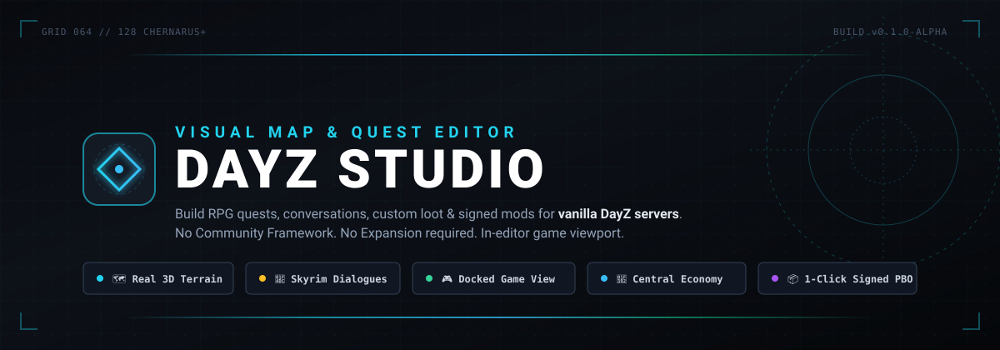
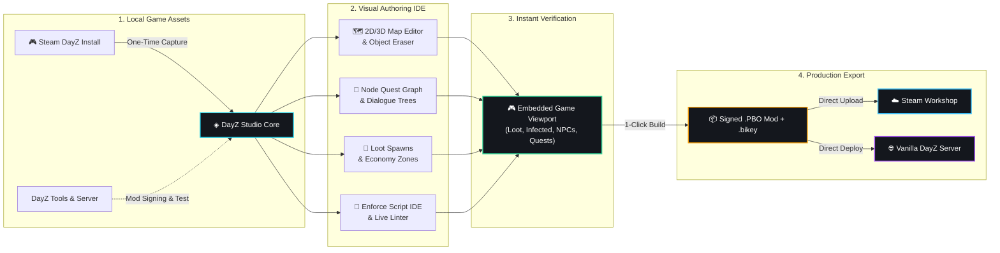
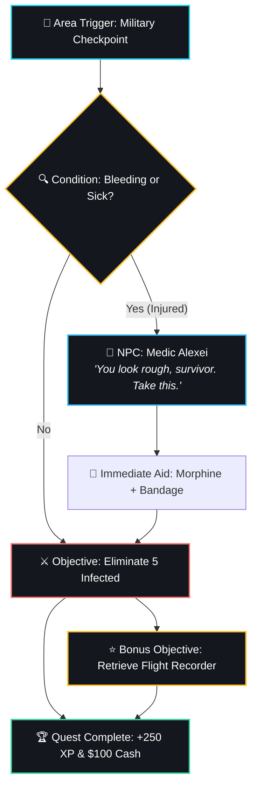

<p align="center">
  
</p>

<p align="center">
  <strong>The all-in-one visual map and RPG quest IDE for vanilla DayZ servers.</strong><br>
  Build living worlds with real terrain, interactive NPC conversations, branching quests, custom loot, and one-click signed mod exports.
</p>

<p align="center">
  <a href="https://github.com/ghosthex-dev/dayz-studio/releases/latest"></a>
  
  
  
  
  <a href="LICENSE"></a>
</p>

<p align="center">
  <a href="https://ghosthex-dev.github.io/dayz-studio/"><b>🌐 Live Showcase Site</b></a> •
  <a href="#quick-start"><b>🚀 Quick Start</b></a> •
  <a href="https://github.com/ghosthex-dev/dayz-studio/releases/latest"><b>📥 Download Setup (.exe)</b></a> •
  <a href="#why-dayz-studio"><b>💡 Why DayZ Studio?</b></a> •
  <a href="#feature-tour"><b>✨ Feature Tour</b></a> •
  <a href="#workflow"><b>🔄 Workflow</b></a> •
  <a href="#shortcuts"><b>⌨️ Shortcuts</b></a> •
  <a href="#troubleshooting"><b>🔧 Troubleshooting</b></a> •
  <a href="https://github.com/ghosthex-dev/dayz-studio/issues"><b>💬 Issues &amp; Feedback</b></a>
</p>

---

> [!NOTE]
> **Fan-Made & Safe:** DayZ Studio is an independent fan-made tool and is not affiliated with Bohemia Interactive. The repository contains only the editor's original code. Terrain, models, textures, and economy definitions are extracted locally from **your own** Steam DayZ installation on first run and remain on your PC.

---

<a id="why-dayz-studio"></a>
## 💡 Why DayZ Studio?

Traditional DayZ map editing and quest writing require managing half a dozen clunky external tools, complex JSON configs, manual Enforce scripting, and heavy server mod dependencies like Community Framework (CF) or DayZ Expansion. 

**DayZ Studio changes that completely:**

| Capability | Traditional DayZ Modding | With DayZ Studio ◈ |
| :--- | :--- | :--- |
| **Server Dependencies** | Requires CF, Dabs Framework, Expansion, or custom mod suites | **100% Vanilla Server Compatible.** Players need zero third-party frameworks |
| **Map & Terrain Fidelity** | Flat 2D maps or desynced 3D coordinates | **Real In-Game Terrain.** Satellite imagery, heightmaps & ODOL 3D building meshes |
| **Object Eraser** | Manual coordinates in `init.c` or cumbersome delete files | **Visual 1-Click Eraser.** Click any vanilla tree, wall, or building to erase |
| **Quest System** | Scripting triggers & dialogues manually in Enforce/JSON | **Visual Node Graph.** Skyrim-style dialogue trees, voice-lines & quest chains |
| **Testing Iteration** | Repack PBO ➔ Sign key ➔ Restart server (5–10 min loop) | **Docked In-Editor Game Viewport.** Walk through edits with live Central Economy (<10s) |
| **Economy & Loot** | Manual XML editing (`types.xml`, `mapgrouppos.xml`) | **Visual Loot Spawns & Zones.** Draw loot tiers & usage polygons directly on map |
| **Export & Deployment** | Manual command-line binarizing (`DSUtils`, `MakePbo`) | **Automated 1-Click Signed PBO.** Generates signed `.pbo`, `.bikey` & `INSTALL.txt` |
| **Steam Workshop** | Manual command line publishing tools or batch scripts | **Direct Workshop Publishing.** 1-click upload PBO, keys & changelogs via Steam |

---

<a id="workflow"></a>
## 🔄 Architecture & Workflow

DayZ Studio interfaces directly with your local DayZ game files, giving you a lightning-fast visual authoring loop:



---

<a id="quick-start"></a>
## 🚀 Quick Start

### 1. Prerequisites (Free on Steam)

| Tool | Purpose | Where to Find |
| :--- | :--- | :--- |
| **DayZ** | Studio reads terrain, models, and classes from your game install | Steam Client |
| **DayZ Tools** | Automatically binarizes and cryptographically signs your exported `.pbo` mods | Steam ▸ Library ▸ Tools ▸ **DayZ Tools** |
| **DayZ Server** *(Optional)* | Test multiplayer quest syncing & local server compilation straight from the IDE | Steam ▸ Library ▸ Tools ▸ **DayZ Server** |

---

### 2. Install DayZ Studio

Download **`DayZStudio-Setup-<version>.exe`** from the [Latest Release](https://github.com/ghosthex-dev/dayz-studio/releases/latest) and run the installer. Python, runtime dependencies, and the desktop shell are all bundled.

* **Single-user install:** Installs to `%LOCALAPPDATA%\DayZStudio` with no administrator privileges needed.
* **Auto-Updater:** Studio automatically checks for updates on startup (**File ▸ ⟳ Check for updates…**) and updates without losing projects or workspace layouts.
* **Preserved workspace:** Projects and mod signing keys live permanently in `Documents\DayZStudio`, remaining safe across reinstalls and updates.

> [!TIP]
> Because DayZ Studio is an independent alpha tool without a costly EV code-signing certificate, Windows SmartScreen may show *"Windows protected your PC"*. Simply click **More info ▸ Run anyway**.

<details>
<summary><b>Running from Source (ZIP / Git for Developers)</b></summary>

<br>

If you prefer running directly from source:
1. Ensure **Python 3.10+** is installed with `pip install pillow numpy`.
2. *(Optional)* Install **Node.js LTS** for the Electron desktop wrapper.
3. Clone or extract the repository:
   ```bash
   git clone https://github.com/ghosthex-dev/dayz-studio.git
   cd dayz-studio
   ```
4. Launch via helper scripts:
   * **`run_desktop.bat`** — Launches the full Electron desktop app with docked game viewport support.
   * **`run_studio.bat`** — Starts the local web server at `http://localhost:8765` (usable directly in your browser).

To build your own standalone installer:
```bash
python tools\make_installer.py
```
</details>

---

### 3. First-Time Map Setup (~10 minutes, once per map)

Because DayZ Studio distributes zero proprietary game files, it builds its local cache directly from your own game on first run:

1. **🗺 2D Map Imagery:** Open the **Map** view. With nothing selected, click **⬇ Extract … imagery from DayZ** in the right panel.
2. **⚙ Terrain, Buildings & Classes:** Switch to the **Game setup** tab on the left and click **⬇ Capture from the game**. DayZ launches briefly, records map heights and surface bounds, and exits. Then click **☰ Capture class list** (~5,000 game classes).
3. **🌲 3D World Objects:** Press **🌲 Capture world objects** (~3 minutes). This builds the streaming low-poly LOD scene for props, rocks, and trees.

*Supported maps:* **Chernarus+**, **Livonia**, **Sakhal**, **Nasdara**, and future DLC maps automatically discovered from your `DayZ\Addons` directory, plus community terrains like **Namalsk** and **Deer Isle**.

---

### 4. Jump In: The Showcase Project

New to DayZ Studio? Go to **File ▸ Templates & examples ▸ Showcase: camp, factions & RPG**.

This instantly generates a fully playable survivor outpost at the center of the map featuring:
* A **Survivor camp** with a talking NPC trader and quest giver.
* An interactive **supply container** requiring player XP.
* A **Bandit checkpoint** guarded by an armed faction NPC.
* A drivable **car vehicle reward**, reputation adjustments, custom HUD, and custom Enforce nodes.
* Press **▶ Launch** or **Test on local server** to play it immediately!

---

<a id="feature-tour"></a>
## ✨ Feature Tour

### 🗺️ World & Map Engineering

<p align="center">
  <em>Precision mapping on authentic DayZ satellite imagery with full 3D object interaction.</em>
</p>

* **To-Scale 2D Canvas:** Smooth pan & zoom across high-resolution 4096px overviews and 512px zoom tiles extracted directly from your game PBOs.
* **Real ODOL 3D Meshes:** Built-in direct binarized `.p3d` ODOL reader (`tools/odol_reader.py`) renders authentic building models, diffuse textures, and materials.
* **✂ Vanilla Object Eraser:** Click on any vanilla tree, road sign, rock, fence, or building in the 3D view and click **Remove**. Studio hides the object in the editor and automatically compiles clean removal instructions into your mod (`DSMapEditsData` with AI path updates) or Expansion delete lines.
* **3D Transform Gizmo:** Translate, rotate (yaw/pitch/roll), and scale objects in 3D space (`1/2/3` keys). Toggle surface snapping (`O`) to drop objects directly onto roofs, walls, or terrain slope (`N`).
* **Prefab Stamps & Brushes:** Save selected arrangements as reusable `.dzprefab.json` stamps. Paint props across terrain using **Scatter**, **Line**, or **Ring** brushes with randomized rotation and scaling.
* **🔥 Performance Heatmap:** Visualize object density within DayZ's 150 m network bubble (green ➔ yellow ➔ orange ➔ red) to catch FPS drops and server desync before deploying.
* **Cross-Editor Compatibility:** Seamlessly import saves from **DayZ Editor (`.dze` v1–8)**, **DayZ Expansion (`.map` / `.txt`)**, and legacy **`init.c`** `SpawnObject` blocks.

<details>
<summary><b>Technical Details & CLI Utilities (ODOL extraction, scene building)</b></summary>

<br>

* **Building Model Extraction:** `tools/extract_models.py [world]` reads building UVs, materials, and diffuse `.paa` textures from your DayZ PBOs into `textures.json/.bin` and `models.json/.bin`. Use `--tex 256` for sharper textures, or `--no-tex` for geometry only.
* **Streaming Scene Builder:** `tools/build_scene.py` extracts ~2.9 million Chernarus objects via the game engine, sorting them into 250 m LOD chunks for buttery-smooth 3D viewport navigation.
* **Terrain CLI Extraction:**
  ```bash
  pip install pillow
  python tools/extract_maps.py                    # Extracts all maps from auto-detected Steam DayZ
  python tools/extract_maps.py --world nasdara    # Single map extraction
  python tools/worlds.py                          # Lists all available maps on this PC
  ```
</details>

---

### 📜 Skyrim-Style RPG Quests & NPCs

<p align="center">
  <em>Create deep, branching survival RPG questlines with zero script coding required.</em>
</p>



* **Interactive Dialogue Trees:** Players approach an NPC, see a dynamic `[F] Talk` prompt, and enter a cinematic conversation camera. Text types out with 1–4 reply choices, condition checks, and exit buttons.
* **Voice-Line Integration:** Attach custom `.ogg` or `.wav` audio files to any dialogue line. Studio automatically writes the sound shaders and sound sets into the exported mod config.
* **Dynamic Branching & Conditions:** Filter dialogue choices based on held items, player health, bleeding state, time of day (day/night), weather (rain/fog/storm), completed quests, or faction standing.
* **NPC Outfits & Patrol Routes:** Dress NPCs using 31 survivor models, 13 outfit presets (Survivor, Hunter, Soldier, Police, Bandit, Hazmat, etc.), and randomizers. Draw waypoint patrol paths directly on the map with custom wait times, jog speeds, and hostile guard behavior.
* **In-Game Compass HUD & Journal:** Players can track active objectives on their compass, view distance markers, and press **`J`** to open a full in-game Quest Journal with active/completed checklists and quest abandonment options.
* **Bonus Objectives & Chains:** Add optional side objectives marked in gold, or link quests into multi-part story chains with automatic prerequisite gating.

<details>
<summary><b>NPC Patrols, Conversation Conditions & Voice Lines</b></summary>

<br>

* **Patrol Routes:** Click **+ Draw a patrol route** and click waypoints. NPCs move smoothly, yield to players within 3 m who initiate dialogue, and resume patrol when finished. Armed faction guards automatically pause patrol to aim at Hostile players.
* **Audio Voice Lines:** Studio organizes attached audio into `source/<mod>/sounds/` and generates complete `CfgSoundShaders` and `CfgSoundSets` entries in `config.cpp`.
* **Multi-Quest NPCs:** Multiple Talk-to-NPC nodes within 1.5 m coalesce into a single NPC in-game, automatically prioritizing active quests, followed by newly available quests.
</details>

---

### 🎮 Docked Game Viewport & Living World

<p align="center">
  <em>Walk through your edits in the real DayZ engine without leaving the editor window.</em>
</p>

* **Embedded Game Window:** The desktop app embeds a borderless DayZ client directly inside the editor layout. Walk, fly the camera, or teleport (`tp`) to any map location.
* **🎒 Central Economy Live Simulation:** Launches with DayZ's real Central Economy active:
  * Dynamic **loot** spawns in buildings based on your loot definitions.
  * Real **infected** roam towns and react to your character.
  * Wild **animals** and environmental spawns populate the landscape.
  * Toggle **🎒 Loot & infected** off anytime for a peaceful building environment.
* **Bidirectional Live Sync:** Moving an object in Studio updates its position in the game within a second. Selecting an object in-game highlights it in Studio.
* **Live Quest Visualization:** Renders translucent quest trigger cylinders, beacon pillars, and flow lines live inside the running game viewport.

<details>
<summary><b>Standalone Viewport Architecture & CE Details</b></summary>

<br>

* **Zero-Dependency Viewport:** Uses `bridge/DZStudioWorld` (no CF or Dabs required). Launches offline with `-mod=@DZStudioWorld` and an isolated mission sandbox.
* **Central Economy Unpacking:** Economy files (`db/types.xml`, `events.xml`, `mapgrouppos.xml`, `areaflags.map`) are unpacked directly from `worlds_<map>_ce.pbo`. The temporary `storage_*` directory is wiped on every launch for clean, reproducible testing.
* **Dabs Framework Fallback:** For users who prefer the legacy DayZ Editor, the engine dropdown allows switching to Dabs mode at any time.
</details>

---

### 🎒 Economy, Factions & Custom Currency

<p align="center">
  <em>Build thriving player hubs, trading posts, and territorial survival factions.</em>
</p>

* **💵 Dollar Bills ($1 – $100):** Real vanilla inventory items (`DSQ_Dollar1` … `DSQ_Dollar100`) that stack up to 1,000 bills, split like rags, and can be traded or looted. Drop in your own custom paper bill textures anytime via `Documents\DayZStudio\Assets\Currency`.
* **🛒 Interactive Trader Stores:** Attach stores to any NPC. Configure two-column buy/sell lists with stock limits, quantity trades, and condition locks (e.g. *"Requires Friendly faction standing"*).
* **🏳️ Faction Reputation:** Establish factions (Survivors, Military, Bandits) with customizable standing ranges (−1000 to +1000). Set dynamic kill rules (reputation gain for killing zombies; penalties for killing faction allies) and territory zones.
* **📊 Player Stats & Item Gating:** Track custom stats like XP, bounties, or skill tiers across player sessions (`players/<steam_id>.json`). Gate high-tier gear with strict requirements (e.g. *"M4A1 requires XP ≥ 300"*).
* **Interactive Usable Objects:** Turn static world props (doors, terminals, lockboxes, power generators) into interactable objects requiring specific key items, XP, or quest steps to unlock.

<details>
<summary><b>Custom Currencies, Economy XML & Loot Zones</b></summary>

<br>

* **Custom Currencies:** Map traders to custom money items (e.g. `Coin_Gold = 100`) or a player bank stat balance.
* **Loot Spawns & Zones:** Edit `mapgrouppos.xml` and `mapgroupproto.xml` visually. Draw custom polygon / rectangle / circle zones onto `areaflags.map` to set or modify tiers (Tier1–Tier4) and usage categories (Military, Coast, Town).
* **Stock & Pricing:** Traders support item quantity trading (hold Shift to trade 10), stock refill on server restarts, and automatic change returned in dollar bills.
</details>

---

### ☁️ 1-Click Signed Mod & Steam Workshop Publishing

<p align="center">
  <em>From visual design to player-ready Steam Workshop mod in a single click.</em>
</p>

* **Automated Cryptographic Signing:** DayZ Studio generates a private keypair (`.biprivatekey` / `.bikey`) inside `Documents\DayZStudio\Keys` and signs every built `.pbo` automatically using DayZ Tools.
* **Direct Steam Workshop Publishing:** Go to **File ▸ ☁ Publish to Steam Workshop…**:
  * Uploads the PBO, signature, public `.bikey`, and auto-generated `mod.cpp` directly through your active Steam client.
  * Automatically writes a first-draft description from project contents and tags the item.
  * Updates existing Workshop items with change notes seamlessly.
* **Ready-to-Deploy ZIP:** Generates a server-ready distribution archive containing:
  * The `@YourMod` folder with signed `.pbo` and config.
  * Public `.bikey` file for the server's `keys/` directory.
  * `INSTALL.txt` step-by-step instructions for server owners.
* **Local Dedicated Multiplayer Server:** Boot a real local `DayZServer_x64.exe` instance with your mod loaded to verify multiplayer RPCs, player reconnection, and BattlEye security.

---

### 🧩 Enforce Script Tools & Live Console

```mermaid
flowchart LR
    IDE["💻 Visual IDE &amp; Nodes"] --> LINT["⚡ Real-Time Syntax Linter"]
    LINT --> BUILD["🧰 Automated PBO Packager"]
    BUILD --> SIGN["🔐 Crypto Signer (.biprivatekey / .bikey)"]
    SIGN --> OUT["📦 @YourMod ZIP + INSTALL.txt"]
    OUT --> TEST["▶ 1-Click Local Dedicated Server Launch"]

    style IDE fill:#14171d,stroke:#22d3ee,stroke-width:2px,color:#fff
    style LINT fill:#14171d,stroke:#fbbf24,stroke-width:2px,color:#fff
    style BUILD fill:#14171d,stroke:#38bdf8,stroke-width:2px,color:#fff
    style SIGN fill:#14171d,stroke:#a855f7,stroke-width:2px,color:#fff
    style OUT fill:#14171d,stroke:#34d399,stroke-width:2px,color:#fff
    style TEST fill:#14171d,stroke:#f97316,stroke-width:2px,color:#fff
```

<p align="center">
  <em>A dedicated Enforce Script IDE with instant feedback and push-button mod distribution.</em>
</p>



* **In-Editor Enforce IDE:** Syntax highlighting, auto-indentation, and a live syntax checker that flags common DayZ script bugs as you type (unclosed brackets, missing semicolons, reserved keywords, invalid assignments).
* **Live Server Console:** Connects directly to `script.log` and RPT logs during local server playtesting. Script errors are translated into plain English and link directly back to the offending quest node.
* **Custom Node Creator:** Wrap custom Enforce snippets into reusable visual node blocks (actions and objective checks) with custom parameters.
* **Pre-Build Verification:** Every build and local server compile runs a project-wide script check. If a syntax bug would prevent DayZ from compiling, the build halts with direct jump links to the problem.

---

### ▦ Modular IDE Workspace

* **Docking & Multi-Monitor:** Drag tabs to rearrange panels, dock side-by-side, or right-click any panel and select **Float in its own window** to span multiple monitors.
* **Workspace Profiles:** Quickly switch between tailored layouts: *Default*, *Mapping*, *Quest Writing*, *Map + Quests Side-by-Side*, *Scripting*, or save your own custom `.dzworkspace.json` profile.
* **Scalable UI:** Scale the entire interface from 80% to 150% for high-DPI displays.

---

<a id="shortcuts"></a>
## ⌨️ Shortcut & Navigation Cheat Sheet

| Category | Shortcut | Action |
| :--- | :--- | :--- |
| **Workspace** | `Alt + 1` … `5` | Switch Views: **Map** (1), **Game** (2), **3D** (3), **Quests** (4), **NPCs** (5) |
| | `Ctrl + \`` | Toggle floating **Script Console** |
| | `Ctrl + Shift + W` | Open **Workspace Layouts & Profiles** menu |
| | `F1` | Open **Help & Keyboard Shortcuts** dialog |
| **3D Navigation** | `1` / `2` / `3` | Switch Gizmo Mode: **Translate** (1), **Rotate** (2), **Scale** (3) |
| | `X` | Toggle **World / Local** coordinate space |
| | `O` | Toggle **Snap to Surfaces** (roofs, walls, terrain) |
| | `End` | Drop selected object to ground |
| | `N` | Align object orientation to terrain slope |
| | `Ctrl` *(hold)* | Temporarily disable grid/surface snapping |
| | `Shift` *(hold)* | Fine rotation (1° increments) |
| | `F` | Fly 3D / Game camera directly to selection |
| **General Editing**| `V` / `H` / `M` | Tool Mode: **Select** (V), **Pan** (H), **Measure** (M) |
| | `G` | Cycle Grid Snap: *Off ➔ 1m ➔ 5m ➔ 10m ➔ 25m ➔ 50m* |
| | `Ctrl + Z` / `Ctrl + Y`| **Undo** / **Redo** |
| | `Ctrl + C` / `Ctrl + V`| **Copy** / **Paste** (pastes precisely at mouse cursor) |
| | `Ctrl + D` | **Duplicate** selected objects |
| | `Delete` | Remove selected object(s) |
| **In-Game Playtest**| `J` | Open **Quest Journal** (Active / Completed) |
| | `T` / `Enter` | **Track / Untrack** selected quest in journal |
| | `A` *(twice)* | **Abandon** quest |
| | `K` | Open **Character Sheet** (Stats, XP, Faction Standings) |

---

<a id="troubleshooting"></a>
## 🔧 Troubleshooting

<details>
<summary><b>"Could not start the studio server"</b></summary>

* Another program is likely occupying port `8765`. Close conflicting background web services or run `run_studio.bat` to see the exact terminal exception.
* If running from source, verify Python is added to your system `PATH` (`python --version`).
</details>

<details>
<summary><b>Black 2D map / "No terrain data yet"</b></summary>

* The selected map has not been extracted yet. Switch to the Map view and click **⬇ Extract … imagery from DayZ** in the right-hand panel.
</details>

<details>
<summary><b>Capture buttons are greyed out</b></summary>

* DayZ was not found in your Steam libraries. Verify DayZ is installed through Steam (Studio scans all registered Steam library folders across all drives).
</details>

<details>
<summary><b>Mod built but shows "Not signed"</b></summary>

* DayZ Tools is required to sign mods. Install **DayZ Tools** from Steam (Library ▸ Tools ▸ DayZ Tools), ensure it has run at least once to configure file paths, then export again.
</details>

<details>
<summary><b>Kicked from local test server with "Game restart required"</b></summary>

* Dedicated servers enforce BattlEye security. Join through Studio's **② Join with the game** button, which properly launches DayZ with BattlEye enabled.
</details>

<details>
<summary><b>Windows SmartScreen: "Windows protected your PC"</b></summary>

* DayZ Studio is an unsigned alpha executable. Click **More info** and then click **Run anyway**.
</details>

---

## ✍️ A Personal Note on Development & AI

> While I utilized Claude to streamline aspects of development, DayZ Studio is by no means an automated AI creation. Countless hours of my own intense effort, problem-solving, architectural planning, and personal dedication went into building and refining this project. Far from being generic "AI slop," this is the result of genuine work and creative passion. I ask that you please respect the time and effort that went into bringing this project to life.

---

## ⚖️ Legal & Disclaimer

DayZ Studio is a free, fan-made open-source tool and is not affiliated with, endorsed by, or sponsored by Bohemia Interactive. 
* All game assets, terrain data, models, and audio remain the intellectual property of Bohemia Interactive or their respective creators.
* DayZ Studio extracts and reads game files directly from the user's legally owned local Steam installation. Do not redistribute extracted game data or raw PBO contents.

---

<p align="center">
  <sub>Crafted with passion for the DayZ modding community. Star ⭐ this repository if you find it helpful!</sub>
</p>
